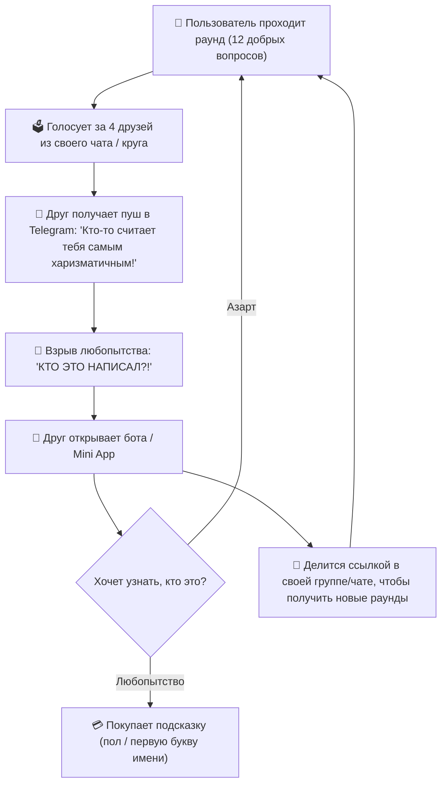

# ⚡ Project Vibe (Gas / TBH Механика)
### Концепция вирального сервиса позитивных анонимных опросов в Telegram

---

## 1. Введение: Почему эта идея сработала на миллионы долларов?

### Предыстория феномена
В 2017 году разработчик Никита Биер (Nikita Bier) запустил приложение **TBH** (*To Be Honest*). Через 9 недель после запуска оно набрало 5 миллионов пользователей и заняло 1-е место в App Store США, после чего его **купил Facebook за ~$100M**.

В 2022 году тот же Никита запустил приложение **Gas** с абсолютно идентичной механикой. Через несколько месяцев оно снова обогнало TikTok и BeReal в App Store, став самым скачиваемым приложением в США, и было **выкуплено Discord**.

### В чем секрет взрыва?
До этого все сервисы анонимных вопросов (**Ask.fm, Спрашивай.ру, Formspring, Sarahah**) неизбежно погибали от одной и той же болезни: **буллинг, токсичность, хейт и угрозы**. Когда людям дают анонимное текстовое поле, они начинают писать гадости.

Никита Биер совершил революционный переворот:
> **Пользователю физически ЗАПРЕЩЕНО писать свой текст.**  
> Все вопросы придуманы заранее, и все они — **исключительно добрые, комплиментарные и поднимающие самооценку**.

В результате получилась идеальная дофаминовая машина: сервис дарит искреннюю радость, социальное признание и исключает любой негатив.

---

## 2. Психология и Виральный Цикл (K-Factor)

В фильме *«Социальная сеть»* Марк Цукерберг понимал: продукт должен распространяться не рекламой, а естественным человеческим эго и любопытством.

---

## 3. Игровая механика (Core Gameplay Loop)

1. **Вход в 1 клик через Telegram Mini App:** Выбор или создание своего комьюнити (ВУЗ, школа, рабочий чат, группа).
2. **Раунд из 12 добрых вопросов:** На экране вопрос + 4 реальных имени с аватарками из сообщества.
3. **Таймер перезарядки (60 минут):** Хочешь играть дальше без ожидания — пригласи друга или поделись в чате.
4. **Уведомление в личку адресату:** Бот пишет в Telegram: *«Кто-то из первокурсников считает тебя самым стильным!»*.

---

## 4. Монетизация любопытства
* **Подсказка пола (парень/девушка):** 25–50 Telegram Stars.
* **Подсказка первой буквы имени:** 50–75 Telegram Stars.
* **Режим «Бога» (God Mode):** Недельный абонемент с раскрытием имен и уведомлениями, когда тебя добавили в варианты.

---

## 5. Юридическая чистота
* **Защита от буллинга:** Текст вопросов фиксирован, пользователь не может ничего написать сам.
* **Безопасность:** Нет сбора паспортов, телефонов или закрытых ПДн (всё работает на открытых Telegram ID).
