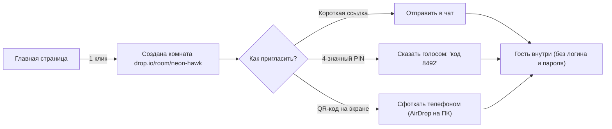

# 🪐 GhostRoom (или DropSpace)
### Концепция эфемерных P2P-переговорных комнат с безлимитной передачей файлов и нулевой регистрацией

---

## 1. Главная идея и УТП (Уникальное торговое предложение)

> **Слоган:** *Создай комнату в 1 клик. Передай файл любого размера напрямую. Закрой вкладку — в мире не останется ни следа.*

### В чем проблема текущих решений?
1. **Мессенджеры (Telegram, WhatsApp):**
   * Жесткие ограничения на размер файлов (2–4 ГБ в Telegram, до 2 ГБ в WhatsApp).
   * Файлы сжимаются или скачиваются медленно.
   * Обязательна регистрация: чтобы перекинуться файлом или быстро созвониться, нужно светить свой личный номер телефона или Telegram-аккаунт.
   * Мусор в истории: рабочий чат засоряется временными файлами навсегда.
2. **Облака (Google Drive, Яндекс.Диск, Dropbox):**
   * Место быстро заканчивается, нужно платить за подписку.
   * Двойная трата времени: сначала залей 20 ГБ в облако (15 минут), потом дай ссылку, потом получатель скачивает еще 15 минут.
3. **Сервисы созвонов (Zoom, Google Meet):**
   * Требуют установки тяжелого софта, входа в Google/Zoom аккаунты, ввод кодов конференций.

### Наше решение: «Zero Friction Web Workspace»
Веб-сайт, куда ты просто заходишь, нажимаешь **[ Создать комнату ]** и получаешь изолированное, защищенное пространство для файлов, текста, аудио и демонстрации экрана.

---

## 2. Авторизация БЕЗ регистрации (Zero-Friction UX)

Процесс подключения должен занимать **менее 3 секунд**:

### Детали механики входа:
* **Идентификация:** Никаких email и паролей. При входе сервис генерирует забавный временный никнейм и стильный аватар (например, *«Cyber Otter»* или *«Midnight Fox»*). При желании можно кликнуть и ввести свое имя.
* **Связка ПК ↔ Телефон (Замена AirDrop):** Открыл сайт на компьютере -> навел камеру смартфона на QR-код комнаты -> телефон мгновенно подключен к ПК. Можно перекидывать фото/видео напрямую без проводов и мессенджеров.
* **Защита «Стук в дверь» (Knock-to-Enter):** Если включен этот режим, гость видит экран ожидания, а создатель комнаты получает пуш: *«Пользователь Alex хочет войти. [Впустить] / [Отклонить]»*.

---

## 3. P2P-передача файлов БЕЗ ограничений (Техническое чудо)

### Как это устроено (WebRTC DataChannel):
* Файлы **НЕ идут через сервер**.
* Устанавливается прямое зашифрованное соединение между браузерами двух устройств (Peer-to-Peer).
* Файл читается чанками (кусочками) из оперативной памяти одного устройства и сразу пишется на диск второго.

### Преимущества:
1. **Любой размер:** 10 ГБ, 50 ГБ, 100 ГБ — видеомонтаж, RAW-фотосессии, архивы баз данных. Нет никаких лимитов.
2. **Максимальная скорость:** Скорость упирается только в интернет-канал пользователей. А если два устройства подключены к одному домашнему/офисному Wi-Fi, файлы передаются по локальной сети на скорости до 1 Гбит/с (за секунды!).
3. **Бесплатно для владельца сервиса:** Сервер не хранит файлы и не сжигает терабайты оплачиваемого трафика. Ваши серверные расходы равны нулю.

---

## 4. Визуальные скины комнат (Секретный соус проекта)

Вместо унылого серого интерфейса — стильные интерактивные переговорные, которые создают настроение:

### 1. 🏢 Swiss Minimal / Executive Boardroom
* Строгий черно-белый минимализм, крупная швейцарская типографика, эффект матового стекла (glassmorphism).
* Идеально для дизайнеров, маркетологов, юристов, агентств и деловых переговоров с клиентами.

### 2. 📟 Cyberpunk / Hacker Terminal
* Темная неоновая палитра (зеленый/бирюзовый/янтарь на глубоком черном), моноширинный шрифт.
* Тактильные ретро-звуки кликов, статус передачи файла в виде анимированных прогресс-баров в стиле sci-fi консоли.

### 3. ☕ Cozy Studio / Lo-Fi Lounge
* Теплые пастельные тона, мягкий приглушенный свет, фоновый встроенный Lo-Fi плеер (инструментальный чилл).
* Ощущение совместной работы в уютной кофейне.

### 4. 🗄️ Secret Vault (Сейф)
* Игровая стилистика: комната выглядит как массивный банковский сейф.
* Передаваемые файлы отображаются как закрытые папки с грифом «TOP SECRET».

---

## 5. Встроенные инструменты внутри комнаты

1. **Эфемерный P2P-чат:**
   * Быстрый обмен ссылками, кодом, номерами карт и паролями.
   * При закрытии комнаты сообщения стираются из памяти навсегда.
2. **Audio & Screen Share в 1 клик:**
   * Кнопка микрофона и кнопка «Показать экран». Без сторонних приложений — встроенные веб-стандарты WebRTC.
3. **Совместный Scratchpad (Черновик):**
   * Совместный Канвас в реальном времени. Можно набросать план встречи, тезисы или список задач.
   * Кнопка «Скачать в Markdown» перед выходом.
4. **Красная кнопка «Паника / Самоуничтожение»:**
   * Моментально разрывает соединение, очищает буфер обмена и кэш вкладки и перенаправляет всех на пустой поисковик.

---

## 6. Как это будет приносить прибыль (Монетизация)?

Благодаря P2P-архитектуре себестоимость обслуживания одного пользователя стремится к нулю. Это делает бизнес **сверхрентабельным (маржа до 90-95%)**.

### Модель A. Pro Pass (Подписка $7–$12/мес или разовая покупка)
* **Постоянная именная ссылка:** Вместо случайной ссылки вы получаете красивый персональный адрес: `ghostroom.io/ivan` или `ghostroom.io/studio`.
* **Свой брендинг (Custom Branding):** Возможность загрузить свой логотип, фавиконку и фирменные цвета. Клиент агентства заходит в переговорную и видит брендовый сервис агентства.
* **Скоростные TURN-сервера:** Гарантированное подключение даже через строгие корпоративные фаерволы банков и госкомпаний, где заблокирован прямой P2P.
* **Локальная запись созвона:** Запись видео/аудио разговора прямо в браузере в файл `.webm / .mp4`.

### Модель B. Платная косметика и темы (B2C)
* Базовые темы (Минимал и Светлая) бесплатны.
* Премиум-темы (Cyberpunk со звуками, Lo-Fi лаунж с радио, Vault) — разовые покупки за 199–390 ₽ или за донаты.

### Модель C. White-Label коробка для корпораций (B2B)
* Продажа готового скрипта для развертывания внутри контура компании (`meet.lawfirm.com`).
* Для юристов, криптофондов и консалтинга конфиденциальность данных — вопрос миллионов рублей.

---

## 7. Юридическая безопасность и защита создателя

В отличие от «анонимных файлообменников старого типа», P2P-архитектура юридически безопасна:

1. **Сервер не хранит данные (Zero-Storage):**
   * На сервере сервиса физически нет жестких дисков с файлами пользователей. Сервер выполняет лишь роль «телефонной книги» (Signaling Server), помогая двум браузерам найти IP друг друга.
   * Нельзя потребовать выдать файл или историю переписки, так как они существуют только в оперативной памяти устройств в момент связи.
2. **E2E-шифрование «из коробки»:**
   * Протокол WebRTC по умолчанию шифрует весь трафик (DTLS/SRTP). Даже провайдер интернета не видит содержимое передаваемых данных.
3. **Позиционирование:**
   * Продукт позиционируется как **«Инструмент быстрой прямой связи и локальной передачи файлов»** (как AirDrop или Bluetooth), а не архив или социальная сеть.

---

## 8. Технологический стек для MVP

* **Frontend:**
  * React / Next.js / Vite
  * Tailwind CSS (стилизация и скины)
  * Lucide Icons (минималистичные иконки)
* **P2P & WebRTC Движок:**
  * `PeerJS` или `simple-peer` (простая и надежная обертка над WebRTC DataChannel)
* **Сигнальный сервер (Signaling):**
  * Node.js + `Socket.io` (управляет комнатами, стуком в дверь и передачей SDP-офферов)
* **STUN/TURN Сервера:**
  * Бесплатные Google STUN (для 80% соединений) + легковесный `Coturn` на VPS (для сложных NAT).

---

## 9. План запуска MVP (за 2 недели)

* **День 1–3:** Базовая верстка интерфейса комнаты (минималистичный стиль) + генератор случайных URL.
* **День 4–7:** Интеграция PeerJS: передача файлов drag-and-drop с индикатором прогресса + P2P текстовый чат.
* **День 8–10:** Добавление аудиосвязи и демонстрации экрана в 1 клик.
* **День 11–12:** Внедрение второго скина (Cyberpunk/Terminal) и звуковых эффектов.
* **День 13–14:** Деплой на Vercel/VPS + тест передачи тяжелого файла (10+ ГБ) между разными устройствами.

---

*Документ сохранен в `E:\Programming\new_temka\P2P_ROOMS_CONCEPT.md`.*
