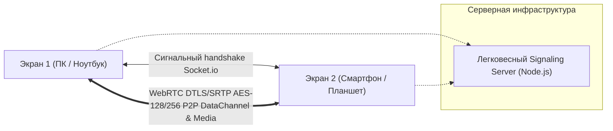

# 🌉 bridgik (bridgik.ru)
### Эфемерный P2P-мост между экранами и переговорные комнаты без регистрации и серверов

[](https://opensource.org/licenses/MIT)
[](https://webrtc.org/)
[](https://eblo.id)
[](https://developer.mozilla.org/en-US/docs/Web/API/File_System_Access_API)

> **Манифест:** *Передай файл любого размера со смартфона на ПК за 3 секунды. Созвонись в тайной комнате без регистрации и логов. Закрой вкладку — 0 байт останется на сервере.*

---

## ⚡ Два режима сервиса

В `bridgik` четко разделены два ключевых сценария использования через верхнее меню:

```
bridgik   [ Мост ]   [ Комната ]   [ О сервисе ]
```

### 1. 🌉 Режим «Мост» (Экспресс-передача телефон ↔ компьютер)
Создан для моментального переброса данных между своими экранами за 3 секунды:
* **Локальный Wi-Fi Радар (Snapdrop-стиль):** устройства в одной сети Wi-Fi автоматически видят друг друга на стартовом экране. Передача в 1 клик без ручного ввода кодов.
* **Direct-to-Disk (Файлы 10, 50+ ГБ):** нарезка на чанки по 64 КБ со сбросом потока напрямую в выбранную папку на диске через File System Access API (без зависания вкладки от переполнения оперативной памяти).
* **Глобальный <kbd>Ctrl + V</kbd>:** сделайте скриншот (<kbd>Win + Shift + S</kbd> на Windows) или скопируйте файл в проводнике и нажмите Ctrl+V в любом месте страницы — файл моментально отправляется на второе устройство.
* **Drag & Drop папок:** перетаскивание целых директорий с автоматическим сохранением относительных путей.
* **Медиа-превью:** миниатюры изображений с полноэкранным просмотрщиком и встроенный плеер аудиозаписей.
* **Мгновенный буфер:** отправка паролей, ссылок и заметок с кнопкой «Скопировать» у получателя.

---

### 2. 🪐 Режим «Комната» (P2P GhostRoom / Переговорная)
Изолированное эфемерное пространство для конфиденциальных созвонов и совместной работы тет-а-тет или группой:
* **Голосовая связь (Opus):** чистый звук без серверной компрессии и задержек облачных сервисов.
* **Демонстрация экрана 60 FPS:** трансляция экрана, окна или отдельной вкладки браузера в высоком разрешении.
* **Совместный Канвас (Canvas):** общий черновик заметок и планов, синхронизирующийся между участниками в реальном времени по WebRTC DataChannel с экспортом в Markdown (`.md`).
* **Чат и вложения встречи:** обмен сообщениями и отправка рабочих документов прямо во время созвона.
* **Кнопка «Паника / Завершить»:** в 1 клик разрывает шифрованные каналы, очищает буфер и стирает комнату.

---

## 🔒 Безопасность и архитектура (Zero-Storage)



1. **0 байт на сервере:** Сервер выполняет исключительно роль сигнального узла (WebRTC Handshake) для обмена SDP-офферами и ICE-кандидатами. Файлы и аудио/видео стримы никогда не проходят через серверные диски.
2. **Локальная скорость роутера:** Если два устройства находятся в одной сети Wi-Fi, трафик циркулирует напрямую через локальный роутер со скоростью 100–1000 Мбит/с без выхода во внешний интернет.
3. **Криптографическая защита:** Сквозное шифрование DTLS (Datagram Transport Layer Security) и SRTP по стандарту WebRTC.
4. **Отсутствие трекеров:** Без cookies, Яндекс.Метрики, Google Analytics, рекламных скриптов или баз данных учетных записей.

---

## 🛠️ Стек технологий

* **Frontend:**
  * React 19 + TypeScript
  * Vite (молниеносная сборка)
  * Tailwind CSS (фирменный ретро-неоновый стиль eblo.id)
  * Lucide Icons
  * Шрифтовая сетка Handjet
  * Синтезатор 8-битных звуков на Web Audio API
* **P2P & WebRTC Движок:**
  * Собственный менеджер `WebRTCManager` на базе нативного `RTCPeerConnection`
  * Два выделенных канала: `controlChannel` (метаданные, Канвас, чат) и `fileChannel` (потоковые бинарные чанки файлов)
  * Автоматическая ренегоциация WebRTC для горячего включения/выключения микрофона и экрана
* **Backend (Signaling):**
  * Node.js + Express
  * Socket.io (сигналы, радар локальной подсети, генерация 4-значных PIN)

---

## 🚀 Быстрый запуск

### Требования
* Node.js 18+
* npm

### Установка и запуск
```bash
# Клонировать репозиторий
git clone https://github.com/your-username/bridgik.git
cd bridgik

# Установить зависимости
npm install
npm --prefix server install
npm --prefix client install

# Запустить проект в режиме разработки (сервер :3001 + клиент :5173)
npm run dev
```

Откройте в браузере:
* На компьютере: `http://localhost:5173`
* На телефоне в той же сети Wi-Fi: адрес из терминала / шапки сервиса (напр. `http://192.168.0.x:5173`)

### Сборка для продакшена
```bash
npm run build
npm start
```

---

## 📄 Лицензия

MIT License — свободное использование для личных и коммерческих целей.
