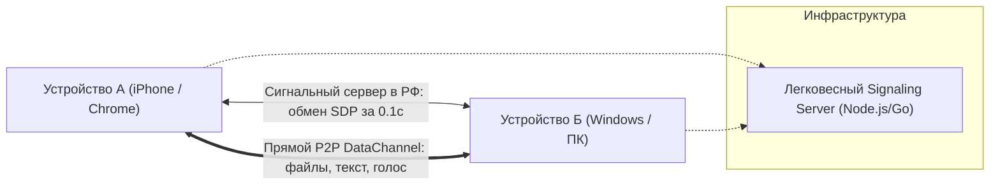

# ⚡ AirBridge (Рабочее название)
### Универсальный P2P-мост для мгновенного обмена файлами, ссылками и текстом между любыми устройствами

---

## 1. Главная идея и миссия продукта

> **Суть:** Мгновенный обмен любыми файлами, ссылками и текстом между любыми людьми и устройствами в 1 клик.  
> **Без регистрации. Без привязки к соцсетям. Без VPN и прокси. Без ограничений по размеру.**

### Почему это нужно прямо сейчас (Реальная боль рынка 2024–2026):
1. **Фрагментация и блокировки в РФ:**
   * Discord заблокирован, популярные зарубежные файлообменники (типа WeTransfer) заблокированы или требуют VPN.
   * Люди постоянно сталкиваются с тем, что сервис у одного работает, а у другого — нет.
   * **Наше решение:** Сервис работает на чистом веб-стеке с серверами в РФ/нейтральной зоне. Открывается в любом браузере на максимальной скорости интернета без VPN.
2. **Проблема «разных соцсетей»:**
   * У одного друга Telegram, у другого только WhatsApp, у третьего вообще нет мессенджеров на рабочем ПК.
   * Чтобы скинуть файл, приходится либо регистрироваться в чужой соцсети, либо слать через e-mail с лимитом 25 МБ.
3. **Кросс-платформенная стена (iPhone ↔ Windows/Android):**
   * AirDrop работает только внутри экосистемы Apple. Скинуть 50 фоток в оригинале с iPhone на чужой ноутбук с Windows — это ад со шнурами или сжатием через Telegram.
   * Наш сервис дает **AirDrop прямо в браузере для всех платформ**.
4. **Приватность личной жизни:**
   * При разовых контактах (клиент, мастер по ремонту, продавец на Авито) люди не хотят светить личный номер телефона и Telegram-профиль с фото семьи. Нужна одноразовая комната.

---

## 2. Как это работает (UX за 5 секунд)

```
┌──────────────────────────────────────────────────────────────┐
│                                                              │
│                         ⚡ AIRBRIDGE                          │
│                                                              │
│              Мгновенный обмен между устройствами             │
│              без регистрации, без соцсетей и VPN             │
│                                                              │
│              ┌────────────────────────────────┐              │
│              │      [ СОЗДАТЬ КОМНАТУ ]       │              │
│              └────────────────────────────────┘              │
│                                                              │
│   Или введите 4-значный код комнаты: [ _ _ _ _ ] [ Войти ]    │
│                                                              │
└──────────────────────────────────────────────────────────────┘
```

### Сценарий использования:
1. **Шаг 1:** Человек заходит на сайт и жмет **[ Создать комнату ]**.
2. **Шаг 2:** Получает короткую ссылку (например, `bridge.ru/4819`) и крупный QR-код.
3. **Шаг 3:** Второй участник:
   * Наводит камеру телефона на QR-код;
   * Либо кликает по ссылке (присланной по СМС или в любой чат);
   * Либо на сайте вбивает код `4819`.
4. **Шаг 4:** Оба внутри переговорной:
   * **Файлы:** Перетащили файл любого объема (10 ГБ, 30 ГБ) — он скачивается напрямую по P2P на максимальной скорости.
   * **Текст и ссылки:** Вставили текст или ссылку — у второго участника загорается кнопка «Скопировать».
   * **Мини-чат / Звонок:** Можно быстро черкнуть пару фраз или созвониться голосом в 1 клик прямо в браузере.
5. **Шаг 5:** Закончили — закрыли вкладку. На сервере не остается ни единого байта.

---

## 3. Техническая архитектура (WebRTC P2P)



* **Сервер не хранит файлы:** Сигнальный сервер лишь помогает устройствам найти IP-адреса друг друга.
* **Трафик идет напрямую (Peer-to-Peer):** Файлы шифруются и передаются между браузерами участников.
* **Локальная скорость:** Если устройства в одной Wi-Fi сети (например, дома или в офисе), данные передаются со скоростью до 1 Гбит/с без выхода в интернет.

---

## 4. Юридический статус и безопасность

1. **152-ФЗ (Персональные данные):**
   * Сервис **НЕ является оператором персональных данных**. Нет регистрации, сбора ФИО, номеров телефонов, email или паролей.
2. **Закон Яровой и ОРИ:**
   * Сервис физически **не хранит и не маршрутизирует** файлы и переписку через свои диски. Это протокол прямой связи (аналог Bluetooth или AirDrop). Невозможно выдать то, чего нет на серверах.
3. **Ответственность за контент:**
   * Сервис — исключительно нейтральный технологический инструмент передачи данных.
   * На сайте обязательно размещаются стандартные *Terms of Service* и *Privacy Policy* с отказом от ответственности за передаваемый пользователями контент.

---

## 5. Монетизация проекта

1. **B2B: Готовая веб-стойка для бизнеса (1 500 – 3 000 ₽ / мес):**
   * Копировальные центры, типографии, отели, сервисные центры.
   * Табличка на стойке: *«Скиньте файл на печать за 1 секунду по QR»*. Клиенту не надо диктовать почту или номер WhatsApp.
2. **Pro-режим для частных пользователей (990 ₽ разовая покупка или 199 ₽/мес):**
   * Постоянное сопряжение своих устройств (ПК + Телефон без сканирования QR каждый раз).
   * Передача папок целиком с сохранением структуры.
   * Сквозной буфер обмена (скопировал на ПК -> вставил на телефоне).
3. **Донаты и спонсорство:**
   * Модель полезного честного open-source инструмента, которому люди охотно донатят.

---

## 6. План разработки MVP (10–14 дней)

* **Этап 1 (Дни 1–3):** Минималистичный веб-интерфейс (Главная + Экран комнаты) на React / Tailwind CSS.
* **Этап 2 (Дни 4–6):** Сигнальный сервер на Node.js (Socket.io) + генерация 4-значных комнат.
* **Этап 3 (Дни 7–10):** Подключение WebRTC (библиотека `PeerJS`): двусторонняя передача файлов drag-and-drop и текста буфера обмена.
* **Этап 4 (Дни 11–12):** Добавление QR-кода, адаптив под мобильные устройства (iOS Safari, Android Chrome).
* **Этап 5 (Дни 13–14):** Деплой на российский VPS (Timeweb/Selectel), привязка домена, тестирование без VPN.

---

*Документ зафиксирован в `E:\Programming\new_temka\README.md`.*
